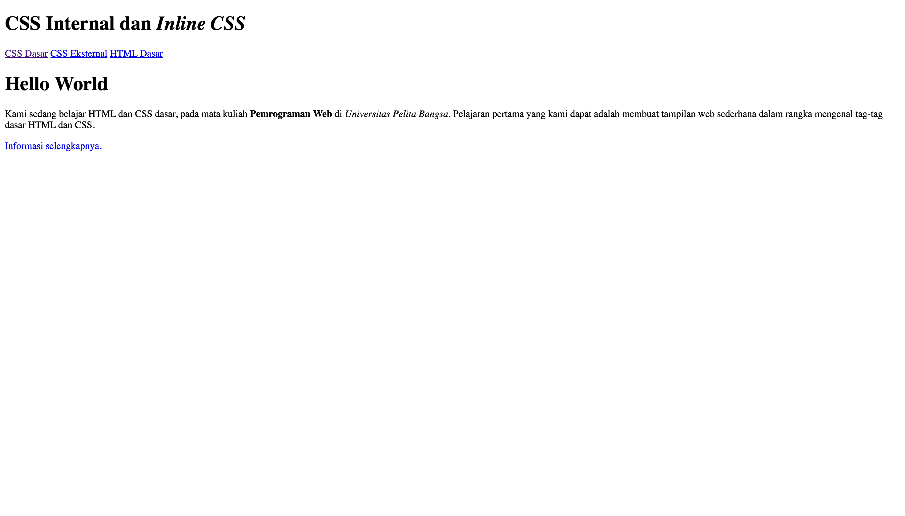
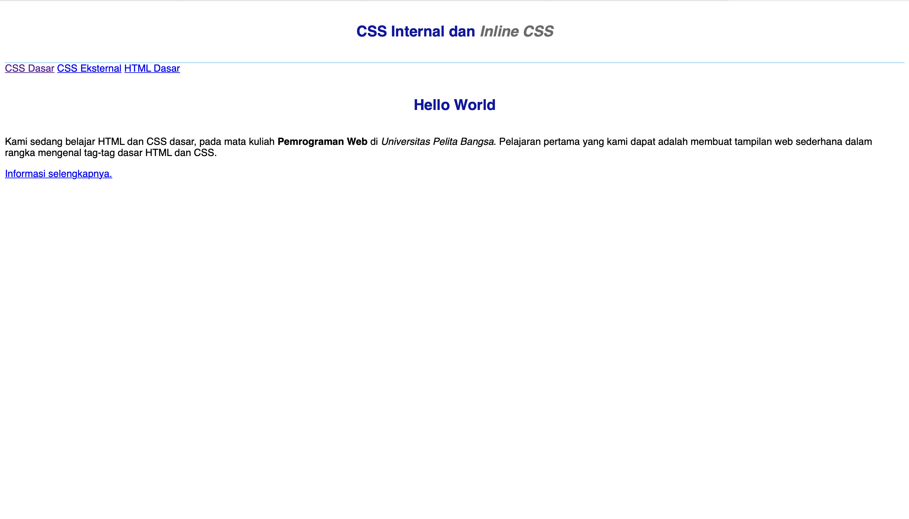
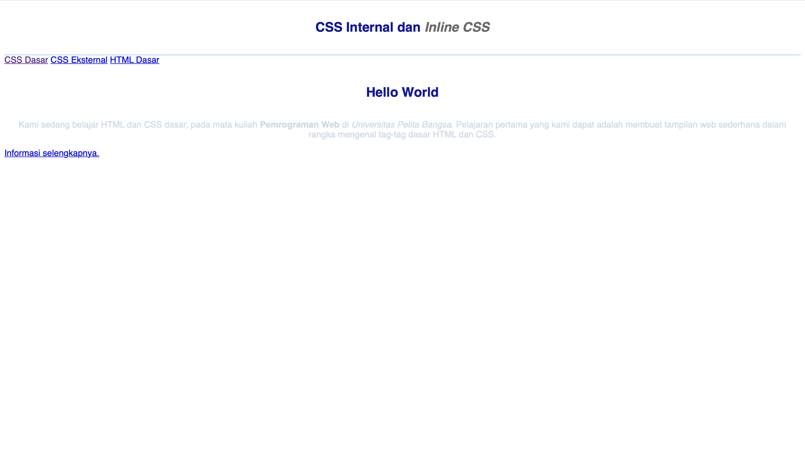
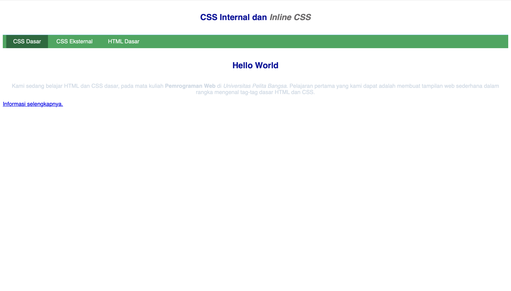
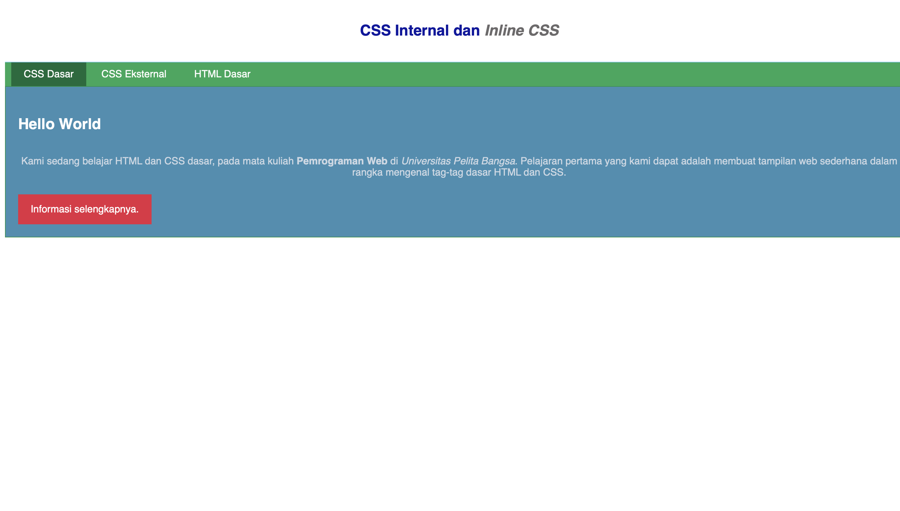
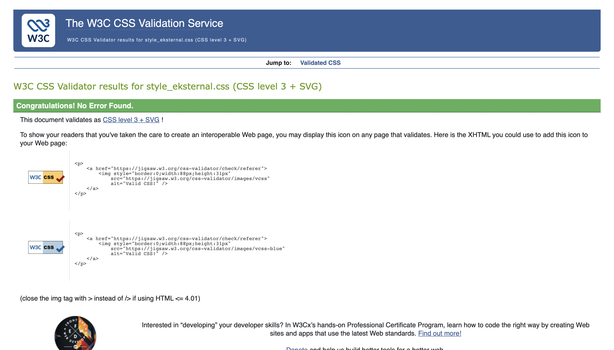
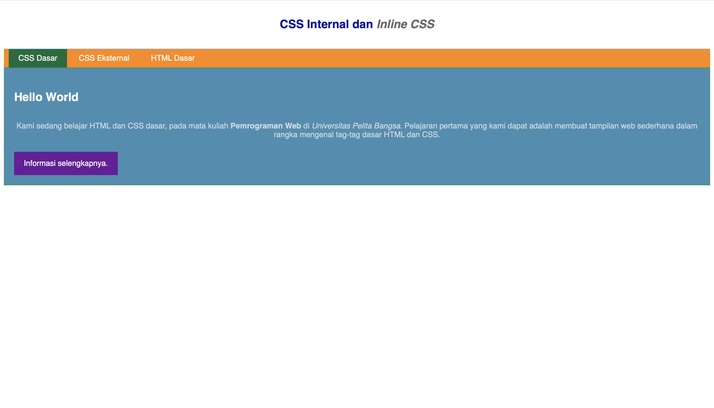

# Laporan Praktikum 3: CSS Dasar

**Mata Kuliah:** Pemrograman Web
**Nama:** Mushlih Hadi
**NIM:** 312600335
**Kelas:** 1251C

## Tujuan

1. Memahami konsep dasar CSS.
2. Memahami aturan penulisan pada CSS.
3. Memahami selector sebagai pengontrol CSS.
4. Membuat pengaturan CSS pada HTML.

## Langkah 1: Membuat Dokumen HTML

Membuat file `lab2_css_dasar.html` berisi struktur dasar HTML: `header` dengan judul `h1`, `nav` dengan tiga tautan, dan `div` ber-id `intro` yang berisi judul, paragraf, dan tautan ber-class `button btn-primary`. Hasil di browser masih berupa tampilan standar tanpa CSS.



## Langkah 2: Mendeklarasikan CSS Internal

Menambahkan tag `<style>` pada bagian `<head>` untuk mengatur `body`, `header`, `h1`, dan `h1 i`. Font body menjadi Open Sans, header diberi garis bawah, judul `h1` menjadi biru, rata tengah, dan ber-padding, sedangkan teks miring di dalam `h1` berwarna abu-abu.



## Langkah 3: Menambahkan Inline CSS

Menambahkan atribut `style="text-align: center; color: #ccd8e4;"` pada tag `<p>`. Paragraf menjadi rata tengah dengan warna biru muda. Inline CSS hanya memengaruhi elemen tempat atribut itu ditulis.



## Langkah 4: Membuat CSS Eksternal

Membuat file `style_eksternal.css` berisi deklarasi untuk `nav`, `nav a`, serta `nav .active` dan `nav a:hover`, lalu menautkannya dengan `<link rel="stylesheet" href="style_eksternal.css" type="text/css">` pada `<head>`. Menu navigasi menjadi berlatar hijau dengan tautan putih.



## Langkah 5: Menambahkan CSS Selector (ID dan Class)

Menambahkan ID selector `#intro` dan `#intro h1`, serta class selector `.button` dan `.btn-primary` pada `style_eksternal.css`. Area intro berlatar biru dengan border hijau, judul `Hello World` menjadi putih rata kiri, dan tautan tampil sebagai tombol merah.



## Langkah 6: Validasi CSS

Memvalidasi `style_eksternal.css` melalui https://jigsaw.w3.org/css-validator/ untuk memastikan tidak ada kesalahan penulisan.



## Pertanyaan dan Tugas

### 1. Eksperimen properti dan nilai CSS

Saya mencoba mengubah dan menambah properti pada kode CSS, misalnya mengganti warna `background` pada `nav`, mengubah `font-size` pada `h1`, serta mengubah `padding` dan `margin` pada `.button`. Setiap perubahan langsung terlihat di browser setelah file disimpan dan halaman di-refresh.

Saya mengubah warna background nav menjadi oranye (#FF8800) dan warna tombol menjadi ungu (#6A1B9A).



### 2. Perbedaan `h1 {...}` dengan `#intro h1 {...}`

`h1 {...}` adalah element selector yang berlaku untuk **semua** elemen `<h1>` pada halaman. `#intro h1 {...}` adalah descendant selector yang hanya berlaku untuk elemen `<h1>` yang berada **di dalam** elemen ber-id `intro`. Selector kedua lebih spesifik, sehingga pada `<h1>` di dalam `#intro` pengaturannya (rata kiri, tanpa border, warna putih) mengalahkan pengaturan `h1` umum (rata tengah, warna biru). Karena itu, judul "CSS Internal dan Inline CSS" tetap biru rata tengah, sedangkan "Hello World" menjadi putih rata kiri.

### 3. Prioritas CSS internal, eksternal, dan inline

Yang tampil di browser adalah **inline CSS**, karena inline memiliki prioritas tertinggi dibanding internal dan eksternal. Untuk internal dan eksternal dengan spesifisitas yang sama, yang menang adalah deklarasi yang **dibaca paling akhir** (letaknya paling bawah di dokumen).

Contoh:

```html
<head>
    <link rel="stylesheet" href="style_eksternal.css">  <!-- p { color: red; } -->
    <style> p { color: blue; } </style>
</head>
<body>
    <p style="color: green;">Teks ini berwarna hijau.</p>
    <p>Teks ini berwarna biru.</p>
</body>
```

Paragraf pertama berwarna hijau (inline menang). Paragraf kedua berwarna biru karena `<style>` internal ditulis setelah `<link>` eksternal. Jika urutannya dibalik, paragraf kedua berwarna merah.

### 4. Prioritas ID dan Class pada satu elemen

Untuk elemen `<p id="paragraf-1" class="textparagraf">`, deklarasi **ID selector** yang ditampilkan jika ada properti yang bentrok, karena ID memiliki spesifisitas lebih tinggi daripada class, tanpa melihat urutan penulisan.

Contoh:

```css
.textparagraf { color: blue; font-size: 20px; }
#paragraf-1   { color: red; }
```

Teks berwarna **merah** (milik ID menang), tetapi `font-size: 20px` tetap berlaku karena properti itu tidak bentrok dan hanya didefinisikan oleh class.

## Kesimpulan

CSS memisahkan tampilan dari konten HTML. CSS dapat ditulis secara internal, eksternal, atau inline, dengan prioritas inline > internal/eksternal (menurut urutan). Selector (element, class, dan ID) menentukan elemen yang diberi gaya, dan ID lebih spesifik daripada class.
